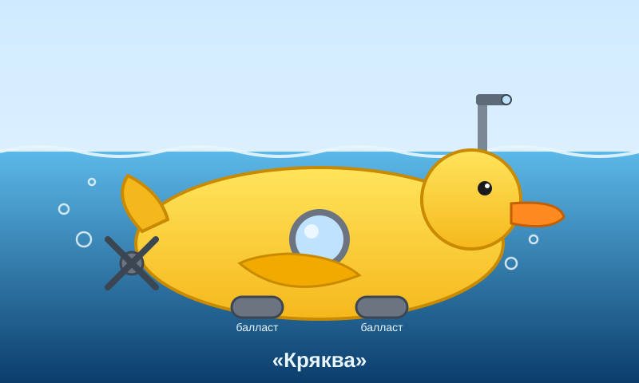

# ТЗ: Утка-подлодка «Кряква»

Автор: Клинный Александр Игоревич (БСБО-16-23, №9)
Стихия: вода
Проект: №9 «Кряква»
Репозиторий: https://github.com/NightFury2283/duck-submarine.git
Дата заморозки: 2026-10-25
Версия: 1.0

| Роль | Участник |
|---|---|
| A — автор ТЗ и тестов | Клинный А. И. (№9) |
| B — ревьюер | Ивчук М. П. (№7) |
| C — ревьюер | Гурьянов М. С. (№5) |
| D — разработчик | Игнатьева М. С. (№8) |

---

## 1. Назначение

«Кряква» — подводная лодка в форме огромной резиновой утки: в клюве перископ, в хвосте винт, а вместо воды в утке — балластные цистерны. Аппарат перевозит одного пилота по рекам и озёрам: плывёт по поверхности; ныряет при движении под водой с достаточно затопленными цистернами; всплывает при движении по поверхности, продувом цистерн ниже порога или аварийно (при пробоине). В отличие от любой другой подлодки, умеет крякать, но тот же запас воздуха уходит на ход, продув и кряк. Ходить по суше резиновая утка не умеет.



---

## 2. Стихия и конструкционный элемент

**Стихия:** вода.

**Конструкционный элемент:** не менее одного элемента, обеспечивающего плавучесть и погружение.

**Как реализован элемент:**

> Балластные цистерны объёмом `ballast_capacity_l` (l - литры). Текущий уровень воды в них — `ballast_l` (от 0 до `ballast_capacity_l`). Порог погружения `dive_threshold_l = ballast_capacity_l × 0.5`. Нырять можно, только если корпус цел (`hull_intact == True`) и цистерны заполнены не меньше порога (`ballast_l ≥ dive_threshold_l`). Продув цистерн ниже порога под водой означает всплытие. Пробоина в корпусе означает аварийное всплытие и запрет нырять до заделки.

**Ограничения стихии:**

- Основной режим — плавание: по поверхности и под водой.
- Под водой медленнее и с повышенным расходом воздуха.
- По суше не передвигается ни в каком виде.

---

## 3. Публичный интерфейс

Разработчик реализует ровно то, что описано в этом разделе. Всё остальное — внутренняя реализация.

### 3.0. Общие правила (действуют для всех методов)

1. **Число** — значение типа `int` или `float`, но **не** `bool`. Нечисловое значение там, где ожидается число, -> `TypeError`.
2. **Конечное число.** Значения `nan`, `inf`, `-inf` — недопустимые числа -> `ValueError` (проверяется вместе с остальными проверками значений).
3. Строковый параметр, переданный не как `str`, -> `TypeError`.
4. Порядок проверок: сначала типы (`TypeError`), затем значения (`ValueError`), затем доменные правила (раздел 6.3). Если нарушений типа несколько, выбрасывается `TypeError` (какой именно параметр назван в сообщении, не специфицируется).
5. **Атомарность:** метод, выбросивший исключение, не меняет состояние объекта.
6. Числовые атрибуты хранятся как `float` (переданный `int` приводится к `float`).
7. Дробные результаты тесты сравнивают с точностью до 6 знаков после запятой.
8. **Сравнения без допуска.** Расход воздуха допустим, если `расход ≤ air`; погружение допустимо, если `ballast_l ≥ dive_threshold_l`. Остаток воздуха никогда не бывает отрицательным.

### 3.1. Класс

```python
class DuckSubmarine:
```

Имя класса: `DuckSubmarine`
Модуль: `duck_submarine.py` (в корне репозитория). В этом же модуле объявлены все исключения раздела 6.

### 3.2. Конструктор

```python
def __init__(
    self,
    name: str,
    mass_kg: float,
    ballast_capacity_l: float,
    max_speed_kmh: float,
    air: float = 100.0,
) -> None:
```

| Параметр | Тип | Единица | Допустимый диапазон | По умолчанию |
|---|---|---|---|---|
| name | str | — | строка, содержащая хотя бы один непробельный символ | — |
| mass_kg | число | кг | конечное, > 0 | — |
| ballast_capacity_l | число | л | конечное, > 0 | — |
| max_speed_kmh | число | км/ч | конечное, > 0 | — |
| air | число | ед. воздуха | конечное, 0 … 100 включительно | 100.0 |

**Исключения конструктора:**

- `TypeError` — `name` не `str`; любой числовой параметр не число (в том числе `bool`, `None`, `str`).
- `ValueError` — `name` пустой или состоит только из пробельных символов.
- `ValueError` — `mass_kg`, `ballast_capacity_l` или `max_speed_kmh` ≤ 0.
- `ValueError` — `air` < 0 или `air` > 100.
- `ValueError` — любой числовой параметр равен `nan`, `inf` или `-inf`.

**Имя** сохраняется ровно так, как передано (пробелы по краям не обрезаются).

**Начальное состояние:** `position_km == 0.0`, `ballast_l == 0.0` (цистерны пусты), `is_submerged == False` (аппарат на поверхности), `hull_intact == True`.

### 3.3. Атрибуты

Все атрибуты **только для чтения**: попытка присвоить значение -> `AttributeError`.

| Атрибут | Тип | Единица | Доступ | Описание |
|---|---|---|---|---|
| name | str | — | чтение | Имя аппарата |
| mass_kg | float | кг | чтение | Полная масса (аппарат + пилот) |
| ballast_capacity_l | float | л | чтение | Объём балластных цистерн |
| max_speed_kmh | float | км/ч | чтение | Максимальная скорость на поверхности |
| air | float | ед. воздуха | чтение | Текущий запас воздуха, 0 … 100 |
| position_km | float | км | чтение | Суммарное пройденное расстояние |
| is_submerged | bool | — | чтение | Находится ли аппарат под водой |
| hull_intact | bool | — | чтение | Цел ли корпус |
| ballast_l | float | л | чтение | Текущий уровень воды в цистернах, 0 … `ballast_capacity_l` |
| dive_threshold_l | float | л | чтение | Порог погружения: `ballast_capacity_l × 0.5` |
| can_dive | bool | — | чтение | `True` ⇔ `hull_intact` и `ballast_l ≥ dive_threshold_l` и `air > 0` |

`can_dive == True` означает, что состояние аппарата допускает погружение. Он **не гарантирует**, что воздуха хватит на конкретную дистанцию: это проверяет `move` (`DuckOutOfAir`).

`can_dive` не зависит от `is_submerged`: даже если аппарат уже находится под водой, при выполнении всех трёх условий (корпус цел, балласт достаточен, воздух есть) он равен `True`.

**Инвариант:** если `is_submerged == True`, то `hull_intact == True` и `ballast_l ≥ dive_threshold_l`.

### 3.4. Методы

#### 3.4.1. move

```python
def move(self, distance_km: float, terrain: str) -> float:
```

**Назначение:** перемещает аппарат на заданное расстояние в заданной среде.

**Параметры:**

- `distance_km` — число, км, конечное, > 0.
- `terrain` — среда: `"surface"` (по поверхности), `"underwater"` (под водой), `"ground"` (суша).

**Возвращает:** время перемещения в часах (`float`).

**Изменяет:** `position_km` (+ `distance_km`), `air` (− расход), `is_submerged`.

**Правила:**

| terrain | Скорость | Расход воздуха | is_submerged после | Дополнительные условия |
|---|---|---|---|---|
| "surface" | max_speed_kmh | distance_km × 1 | False | — |
| "underwater" | max_speed_kmh × 0.5 | distance_km × 4 | True | корпус цел; ballast_l ≥ dive_threshold_l |
| "ground" | — | — | — | всегда `DuckCannotWaddle` |

- Расход, в точности равный запасу, допустим: после перемещения `air == 0`.
- Нырок и всплытие отдельно не моделируются: `move(..., "underwater")` с поверхности означает погружение, `move(..., "surface")` из-под воды — всплытие. Балласт при этом не меняется.

**Исключения** (в порядке проверки):

1. `TypeError` — `distance_km` не число или `terrain` не `str`.
2. `ValueError` — `distance_km` ≤ 0, `nan` или `inf`.
3. `ValueError` — `terrain` не из списка.
4. `DuckCannotWaddle` — `terrain == "ground"`.
5. `DuckHullBreached` — `terrain == "underwater"` и корпус пробит.
6. `DuckTooBuoyant` — `terrain == "underwater"` и `ballast_l < dive_threshold_l`.
7. `DuckOutOfAir` — расход больше текущего `air`.

#### 3.4.2. can_overcome

```python
def can_overcome(self, obstacle: str) -> bool:
```

**Назначение:** проверяет, может ли аппарат в текущем состоянии преодолеть препятствие. Состояние **не меняется**, воздух **не тратится**.

**Параметры:** `obstacle` — `"net"`, `"shallows"`, `"reef"`.

**Возвращает:** `True` / `False`.

**Правила:**

| obstacle | Результат True, если |
|---|---|
| "net" (рыбацкая сеть у поверхности) | `is_submerged` (под сетью можно только нырнув) |
| "shallows" (мель) | `not is_submerged` и `ballast_l < dive_threshold_l` (на мель нельзя с залитыми цистернами) |
| "reef" (риф) | `hull_intact` (с пробоиной об острые камни нельзя) |

Все правила зависят только от **текущего** состояния, а не от возможности его изменить: например, на поверхности с пустыми цистернами сеть не пройти, хотя `can_dive` мог бы быть `True` после затопления.

**Исключения:**

- `TypeError` — `obstacle` не `str`.
- `ValueError` — `obstacle` не из списка.

#### 3.4.3. calculate_air

```python
def calculate_air(self, distance_km: float, terrain: str) -> float:
```

**Назначение:** рассчитывает расход воздуха на перемещение без изменения состояния.

**Параметры:** те же, что у `move`.

**Возвращает:** расход воздуха (`float`) по формуле из 3.4.1. Если в результате умножения на большое расстояние происходит переполнение типа `float`, метод возвращает `inf` (поведение стандартных чисел с плавающей точкой Python).

**Исключения:** `TypeError`, `ValueError`, `DuckCannotWaddle` — как у `move`. **Не** выбрасывает `DuckHullBreached`, `DuckTooBuoyant`, `DuckOutOfAir`: метод считает стоимость, а не проверяет возможность.

#### 3.4.4. refill_air

```python
def refill_air(self, amount: float) -> None:
```

**Назначение:** накачать воздух в баллоны.

**Параметры:** `amount` — число, конечное, > 0.

**Возвращает:** `None`.

**Изменяет:** `air = min(100, air + amount)`.

**Исключения:**

- `TypeError` — `amount` не число.
- `ValueError` — `amount` ≤ 0, `nan` или `inf`.

#### 3.4.5. flood_tanks

```python
def flood_tanks(self, liters: float) -> None:
```

**Назначение:** затопить балластные цистерны (набрать воды). Воздух не тратится. Доступно в любом состоянии, само по себе погружения не вызывает.

**Параметры:** `liters` — число, л, конечное, > 0.

**Возвращает:** `None`.

**Изменяет:** `ballast_l = min(ballast_capacity_l, ballast_l + liters)`.

**Исключения:**

- `TypeError` — `liters` не число.
- `ValueError` — `liters` ≤ 0, `nan` или `inf`.

#### 3.4.6. blow_tanks

```python
def blow_tanks(self, liters: float) -> None:
```

**Назначение:** продуть цистерны сжатым воздухом (вытеснить воду). Доступно в любом состоянии.

**Параметры:** `liters` — число, л, конечное, > 0.

**Возвращает:** `None`.

**Правила:**

- Фактически удаляется `removed = min(liters, ballast_l)`.
- Расход воздуха: `removed × 0.25`.
- Если расход больше `air`, выбрасывается `DuckOutOfAir(required=расход, available=air)`.
- Если после продува `is_submerged == True` и `ballast_l < dive_threshold_l`, аппарат всплывает: `is_submerged = False`. Уровень ровно на пороге не вызывает всплытия.
- Если `removed == 0`, расход равен 0, ошибки нет, состояние не меняется.

**Изменяет:** `ballast_l` (− `removed`), `air` (− расход), `is_submerged`. `position_km` не меняется.

**Исключения** (в порядке проверки):

1. `TypeError` — `liters` не число.
2. `ValueError` — `liters` ≤ 0, `nan` или `inf`.
3. `DuckOutOfAir` — расход больше `air`.

#### 3.4.7. quack

```python
def quack(self, times: int) -> None:
```

**Назначение:** крякнуть. Доступно в любом состоянии (на поверхности, под водой, с пробитым корпусом).

**Параметры:** `times` — количество кряков, `int` (не `bool`), ≥ 1.

**Возвращает:** `None`.

**Изменяет:** `air` (− `times × 1`). Положение, `is_submerged` и остальное состояние не меняются.

**Исключения:**

- `TypeError` — `times` не `int` (в том числе `float`, `bool`, `str`, `None`).
- `ValueError` — `times` < 1.
- `DuckOutOfAir` — `times` > `air`.

#### 3.4.8. breach_hull

```python
def breach_hull(self) -> None:
```

**Назначение:** доменное событие «корпус пробит» (щука, коряга, камень).

**Изменяет:** `hull_intact = False`; `is_submerged = False` (аварийное всплытие). `position_km`, `air` и `ballast_l` не меняются.

**Исключения:** нет. Повторный вызов ничего не меняет.

#### 3.4.9. patch_hull

```python
def patch_hull(self) -> None:
```

**Назначение:** заделать пробоину.

**Изменяет:** `hull_intact = True`. Остальное состояние (включая `is_submerged` и `position_km`) не меняется. После заделки пробоины аппарат остаётся на поверхности, поскольку ранее всплыл при `breach_hull()`. Вызов при целом корпусе ничего не меняет, даже если аппарат находится под водой.

**Исключения:** нет. Вызов при целом корпусе ничего не меняет.

#### 3.4.10. get_status

```python
def get_status(self) -> dict:
```

**Назначение:** возвращает снимок состояния.

**Возвращает:** **новый** словарь ровно с ключами:

| Ключ | Тип |
|---|---|
| "name" | str |
| "air" | float |
| "position_km" | float |
| "is_submerged" | bool |
| "hull_intact" | bool |
| "ballast_l" | float |
| "can_dive" | bool |

Изменение возвращённого словаря не влияет на объект.

### 3.5. Сводка констант домена

| Величина | Значение |
|---|---|
| Порог погружения | 0.5 от `ballast_capacity_l` |
| Скорость на поверхности | max_speed_kmh |
| Скорость под водой | max_speed_kmh × 0.5 |
| Расход воздуха на поверхности | 1 ед. на 1 км |
| Расход воздуха под водой | 4 ед. на 1 км |
| Расход воздуха на кряк | 1 ед. на 1 кряк |
| Расход воздуха на продув | 0.25 ед. на 1 л удалённой воды |
| Максимальный запас воздуха | 100 ед. |

---

## 4. Сценарии

Если не сказано иное, используется эталонный аппарат: `DuckSubmarine("Кряква", mass_kg=80, ballast_capacity_l=200, max_speed_kmh=10)` — порог погружения 100 л, воздух 100, цистерны пусты, на поверхности.

### 4.1. Модульные тесты (AAA)

**Сценарий 1. Плавание по поверхности** (-> TC-05)
Дано: эталонный аппарат.
Когда: `move(5, "surface")`.
Тогда: возвращается `0.5`; `position_km == 5`; `air == 95`; `is_submerged == False`.

**Сценарий 2. Погружение** (-> TC-06)
Дано: эталонный аппарат, `flood_tanks(120)`.
Когда: `move(5, "underwater")`.
Тогда: возвращается `1.0`; `position_km == 5`; `air == 80`; `is_submerged == True`.

**Сценарий 3. Мало балласта** (-> TC-10)
Дано: цистерны затоплены на 50 л (меньше порога 100 л).
Когда: `move(1, "underwater")`.
Тогда: `DuckTooBuoyant`; `can_dive == False`; состояние не изменилось.

**Сценарий 4. Нехватка воздуха** (-> TC-09)
Дано: `air = 10`.
Когда: `move(20, "surface")`.
Тогда: `DuckOutOfAir` с `required == 20`, `available == 10`; состояние не изменилось.

### 4.2. Функциональные (сценарные) тесты (GWT)

Сценарии управляются тестовыми обёртками, они живут в `tests/` и не входят в реализацию:

- **Pilot** — пилот, отдаёт команды на доменном языке: `плыть_по_поверхности(км)`, `плыть_под_водой(км)`, `идти_по_суше(км)`, `может_преодолеть(препятствие)`, `затопить_цистерны(литры)`, `продуть_цистерны(литры)`, `крякнуть(раз)`, `накачать_воздух(количество)`, `заделать_пробоину()`.
- **Pike** — щука-диверсант, событие внешнего мира: `укусить(аппарат)` пробивает корпус.

#### Сценарий 5. Доставка кувшинок (-> TC-26)

```gherkin
Given эталонная «Кряква» с воздухом 100 на поверхности
When пилот плывёт по поверхности 10 км
Then время 1.0 ч
And воздух 90, пройдено 10 км, аппарат на поверхности
When пилот проверяет, пройдёт ли мель, и пройдёт ли сеть
Then мель пройдёт, сеть нет
When пилот затапливает цистерны на 120 л
Then нырять можно (can_dive == True)
And мель теперь не пройти
When пилот плывёт под водой 5 км
Then время 1.0 ч
And воздух 70, пройдено 15 км, аппарат под водой
When пилот проверяет сеть
Then пройдёт
When пилот крякает 3 раза
Then воздух 67
When пилот пытается плыть под водой 20 км
Then DuckOutOfAir: нужно 80, есть 67
And пройдено по-прежнему 15 км, воздух 67, аппарат под водой
When пилот накачивает 30 воздуха и плывёт под водой 20 км
Then время 4.0 ч
And воздух 17, пройдено 35 км, аппарат под водой
```

#### Сценарий 6. Щука-диверсант (-> TC-27)

```gherkin
Given эталонная «Кряква» с воздухом 100, цистерны затоплены на 150 л
When пилот плывёт под водой 4 км
Then время 0.8 ч
And воздух 84, пройдено 4 км, аппарат под водой
When щука кусает корпус
Then корпус пробит, аппарат совершил аварийное всплытие
And can_dive == False
When пилот пытается нырнуть на 2 км
Then DuckHullBreached
And воздух 84, пройдено 4 км
When пилот проверяет, пройдёт ли риф
Then не пройдёт
When пилот плывёт по поверхности 6 км
Then время 0.6 ч, воздух 78, пройдено 10 км
When пилот заделывает пробоину
Then корпус цел, can_dive == True, аппарат по-прежнему на поверхности
And риф пройдёт
When пилот плывёт под водой 5 км
Then время 1.0 ч, воздух 58, пройдено 15 км, аппарат под водой
```

#### Сценарий 7. Аварийное всплытие (-> TC-28)

```gherkin
Given «Поплавок»: масса 60 кг, цистерны 100 л, скорость 8 км/ч, воздух 60
Then порог погружения 50 л
When пилот затапливает цистерны до краёв и плывёт под водой 4 км
Then время 1.0 ч, воздух 44, аппарат под водой
When пилот продувает 30 л
Then балласт 70, воздух 36.5, аппарат всё ещё под водой
And сеть пройдёт
When пилот продувает ещё 20 л
Then балласт ровно 50 (порог), воздух 31.5, аппарат всё ещё под водой
When пилот продувает ещё 10 л
Then балласт 40 ниже порога: аппарат автоматически всплывает, воздух 29
And мель пройдёт, сеть нет
When пилот пытается нырнуть на 1 км
Then DuckTooBuoyant, состояние не изменилось
When пилот затапливает 80 л
Then балласт 100 (не больше ёмкости)
When пилот плывёт под водой 2 км
Then время 0.5 ч, воздух 21, пройдено 6 км, аппарат под водой
```

#### Сценарий 8. Утка на берегу (-> TC-29)

```gherkin
Given эталонная «Кряква» с воздухом 40 на поверхности
When пилот пытается идти по суше 1 км
Then DuckCannotWaddle, состояние не изменилось
And сеть не пройдёт, мель и риф пройдут
When пилот плывёт по поверхности 30 км
Then время 3.0 ч, воздух 10, пройдено 30 км
When пилот пытается идти по суше 5 км
Then снова DuckCannotWaddle
When пилот крякает 10 раз
Then воздух 0
When пилот пытается плыть по поверхности 1 км
Then DuckOutOfAir: нужно 1, есть 0
When пилот пытается идти по суше 1 км при воздухе 0
Then DuckCannotWaddle (проверка суши раньше проверки воздуха)
When пилот накачивает 1000 воздуха
Then воздух 100 (не больше максимума)
And итог: пройдено 30 км, аппарат на поверхности
```

#### Сценарий 9. Последний пузырёк (-> TC-30)

```gherkin
Given эталонная «Кряква» с воздухом 100, цистерны затоплены на 100 л
When пилот плывёт под водой 25 км
Then время 5.0 ч, воздух 0, пройдено 25 км, аппарат под водой
And can_dive == False, но сеть и риф пройдут, мель нет
When пилот пытается всплыть на 0.5 км
Then DuckOutOfAir: нужно 0.5, есть 0
And аппарат остаётся под водой, пройдено по-прежнему 25 км
When пилот пытается крякнуть
Then DuckOutOfAir: нужно 1, есть 0
When пилот пытается продуть 20 л
Then DuckOutOfAir: нужно 5, есть 0
And балласт по-прежнему 100, аппарат под водой
When пилот затапливает ещё 50 л
Then балласт 150 (воздух для затопления не нужен)
When пилот накачивает 10 воздуха
Then воздух 10, can_dive == True
When пилот всплывает на 5 км
Then время 0.5 ч, воздух 5, пройдено 30 км, аппарат на поверхности
When пилот ныряет на 1 км
Then время 0.2 ч, воздух 1, пройдено 31 км, аппарат под водой
```

#### Сценарий 10. Ровно на пороге (-> TC-31)

```gherkin
Given «Ровня»: масса 70 кг, цистерны 100 л, скорость 20 км/ч, воздух 30
When пилот затапливает 50 л
Then балласт равен порогу, can_dive == True
And мель не пройти
When пилот плывёт под водой 4 км
Then время 0.4 ч, воздух 14, пройдено 4 км, аппарат под водой
When щука кусает корпус
Then аварийное всплытие, can_dive == False
When пилот продувает 50 л
Then балласт 0, воздух 1.5
When пилот заделывает пробоину
Then корпус цел, но can_dive == False, потому что цистерны пусты
When пилот пытается нырнуть на 1 км
Then DuckTooBuoyant
When пилот затапливает 50 л
Then can_dive == True
When пилот пытается нырнуть на 1 км
Then DuckOutOfAir: нужно 4, есть 1.5
And состояние не изменилось
When пилот накачивает 10 воздуха и ныряет на 2 км
Then время 0.2 ч, воздух 3.5, пройдено 6 км, аппарат под водой
```

### 4.3. Test Case Specification

Таблица тест-кейсов — в [TEST_CASES.md](TEST_CASES.md). Каждый тест-метод содержит ID своего TC в имени и docstring.

---

## 5. Граничные случаи

| Случай | Ожидание | TC |
|---|---|---|
| Расход ровно равен запасу: `move(100, "surface")` при `air = 100`; `move(25, "underwater")` при `air = 100` | `air == 0`, перемещение выполнено, без исключения | TC-09 |
| Балласт ровно на пороге (100 л при ёмкости 200 л) | нырять можно; при 99.9 л — `DuckTooBuoyant` | TC-10 |
| Продув до уровня ровно на пороге под водой | аппарат остаётся под водой; продув ещё на 1 л — всплытие | TC-19, TC-28 |
| `refill_air(1000)` при `air = 50`; `flood_tanks(1000)` | `air == 100`; `ballast_l == ballast_capacity_l`, не больше | TC-16, TC-17 |
| `bool` вместо числа: `mass_kg=True`, `move(True, "surface")`, `quack(True)` | `TypeError`, хотя `bool` — подкласс `int` | TC-03, TC-08, TC-21 |
| `nan` или `inf` вместо числа | `ValueError` | TC-02, TC-08, TC-13, TC-16, TC-17, TC-20 |
| Имя из одних пробелов `"   "`; имя `" Кряква "` | `ValueError`; имя сохраняется без обрезки | TC-02, TC-01 |
| Несколько нарушений сразу: пробоина и пустые цистерны; суша и `air = 0` | `DuckHullBreached`; `DuckCannotWaddle` (порядок проверок 6.3) | TC-12 |
| `air == 0` под водой | аппарат остаётся под водой, `can_dive == False`, «сеть» пройдёт | TC-14, TC-30 |
| `blow_tanks` на пустых цистернах при `air = 0` | без ошибки, состояние не меняется | TC-18 |

---

## 6. Исключения

### 6.1. Иерархия

```
Exception
└── CrazyVehicleError
    └── DuckError
        ├── DuckCannotWaddle
        ├── DuckOutOfAir
        ├── DuckTooBuoyant
        └── DuckHullBreached
```

Ошибки параметров — стандартные исключения (`TypeError`, `ValueError`). Нарушения правил домена — доменные исключения. `RuntimeError` не используется.

`DuckOutOfAir` создаётся как `DuckOutOfAir(required: float, available: float)` (аргументы можно передавать и по имени) и имеет публичные атрибуты `required: float` (сколько воздуха нужно) и `available: float` (сколько есть). Остальные доменные исключения создаются со строкой-сообщением.

### 6.2. Таблица

| Ситуация | Исключение | Сообщение |
|---|---|---|
| Параметр неверного типа | TypeError | "<param> must be a number" / "<param> must be a string" / "times must be an int" |
| Пустое имя | ValueError | "name must not be empty" |
| Неположительные масса / ёмкость / скорость | ValueError | "<param> must be positive" |
| Воздух вне 0…100 при создании | ValueError | "air must be between 0 and 100" |
| Неположительная дистанция | ValueError | "distance_km must be positive" |
| `nan` или `inf` вместо числа | ValueError | "<param> must be finite" |
| Неизвестная среда / препятствие | ValueError | "unknown terrain: <x>" / "unknown obstacle: <x>" |
| Неположительное количество воздуха / воды | ValueError | "amount must be positive" / "liters must be positive" |
| Меньше одного кряка | ValueError | "times must be at least 1" |
| Попытка идти по суше | DuckCannotWaddle | "duck cannot waddle: the ground is not water" |
| Не хватает воздуха | DuckOutOfAir | "not enough air: required X, have Y" |
| Цистерны заполнены меньше порога | DuckTooBuoyant | "too buoyant to dive: ballast X l, need Y l" |
| Нырок с пробитым корпусом | DuckHullBreached | "hull is breached" |

Тесты проверяют тип исключения и атрибуты `required` / `available`. Текст сообщения тестами не проверяется.

### 6.3. Порядок проверок

`TypeError` -> `ValueError` -> `DuckCannotWaddle` -> `DuckHullBreached` -> `DuckTooBuoyant` -> `DuckOutOfAir`. При нескольких нарушениях выбрасывается первое по этому порядку.

---

## 7. Что вне рамок

- Глубина, давление, течение, погода и температура воды не моделируются.
- Нырок и всплытие не являются отдельными действиями (см. 3.4.1).
- Груз и изменение массы после создания не поддерживаются; масса на плавучесть не влияет.
- Аппарат не взаимодействует с другими транспортами.
- Температура и состав воды, освещение и связь не моделируются.
- Нет графики и визуализации в коде (картинка в ТЗ только иллюстрирует).
- Нет сохранения состояния между запусками, работы с файлами, сетью и API.

---

## 8. Трассируемость «требование -> тест»

| Требование | Раздел ТЗ | Тест |
|---|---|---|
| Корректное создание, начальное состояние, int -> float | 3.0, 3.2, 3.3 | test_tc01_init_valid_defaults |
| Значения конструктора, nan/inf, имя | 3.0, 3.2 | test_tc02_init_invalid_values_raise |
| Типы параметров конструктора, приоритет типов | 3.0, 3.2 | test_tc03_init_wrong_types_raise |
| Атрибуты только для чтения | 3.3 | test_tc04_attributes_read_only |
| Плавание по поверхности: скорость, расход, позиция | 3.4.1 | test_tc05_move_surface |
| Погружение и всплытие: скорость ×0.5, расход ×4 | 3.4.1 | test_tc06_move_underwater_and_surfacing |
| Суша запрещена | 3.4.1 | test_tc07_move_ground_raises_cannot_waddle |
| Недопустимые значения и типы move | 3.0, 3.4.1 | test_tc08_move_invalid_args |
| Нехватка воздуха, атомарность, расход ровно равен запасу | 3.0, 3.4.1, 5 | test_tc09_move_out_of_air_and_exact_budget |
| Порог погружения и его граница | 2, 3.3, 3.4.1, 5 | test_tc10_dive_ballast_threshold |
| Пробоина запрещает нырять, но не плавать | 2, 3.4.1 | test_tc11_hull_breach_blocks_dive_not_surface |
| Порядок проверок | 3.0, 6.3 | test_tc12_move_check_priority |
| Расчёт воздуха без изменения состояния, ошибки | 3.4.3 | test_tc13_calculate_air |
| Правила препятствий (матрица 3 × 6) | 3.4.2 | test_tc14_can_overcome_matrix |
| Неверные препятствия | 3.4.2 | test_tc15_can_overcome_invalid |
| Накачка воздуха, потолок 100, ошибки | 3.4.4 | test_tc16_refill_air |
| Затопление цистерн, потолок ёмкости, ошибки | 3.4.5 | test_tc17_flood_tanks |
| Продув: значения, расход по фактическому объёму | 3.4.6 | test_tc18_blow_tanks_values |
| Продув ниже порога под водой — всплытие | 2, 3.4.6, 5 | test_tc19_blow_tanks_surfacing_rule |
| Ошибки продува, нехватка воздуха | 3.4.6 | test_tc20_blow_tanks_errors |
| Кряк: расход, любые состояния, ошибки | 3.4.7 | test_tc21_quack |
| Пробоина — аварийное всплытие | 3.4.8 | test_tc22_breach_hull |
| Заделка пробоины | 3.4.9 | test_tc23_patch_hull |
| Статус: ключи, значения, копия | 3.4.10 | test_tc24_get_status |
| Иерархия исключений | 6.1 | test_tc25_exception_hierarchy |
| Сценарий «Доставка кувшинок» | 4.2, сц. 5 | test_tc26_lily_delivery |
| Сценарий «Щука-диверсант» | 4.2, сц. 6 | test_tc27_pike_saboteur |
| Сценарий «Аварийное всплытие» | 4.2, сц. 7 | test_tc28_emergency_surfacing |
| Сценарий «Утка на берегу» | 4.2, сц. 8 | test_tc29_duck_on_shore |
| Сценарий «Последний пузырёк» | 4.2, сц. 9 | test_tc30_last_bubble |
| Сценарий «Ровно на пороге» | 4.2, сц. 10 | test_tc31_exactly_at_threshold |

---

## 9. Открытые вопросы

Поведение, зафиксированное в разделах 3–5 и проверяемое тестами, открытым вопросом не считается. Ниже только то, что на тесты версии 0.1 не влияет.

- Нужна ли отдельная операция всплытия без перемещения? Сейчас всплытие возможно только через `move(..., "surface")`, продув ниже порога или пробоину.
- Стоит ли в будущем моделировать глубину и давление (расход воздуха растёт с глубиной), или плоская модель «поверхность / под водой» — часть идеи аппарата?
- Стоит ли разрешить сушу (утка ковыляет вперевалку с очень высоким расходом), или запрет — часть идеи?
- Нужно ли ограничить число кряков за один вызов?
